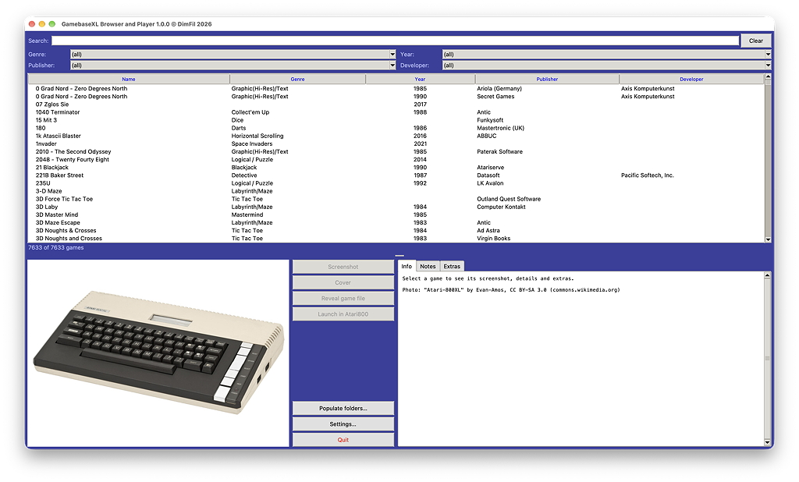
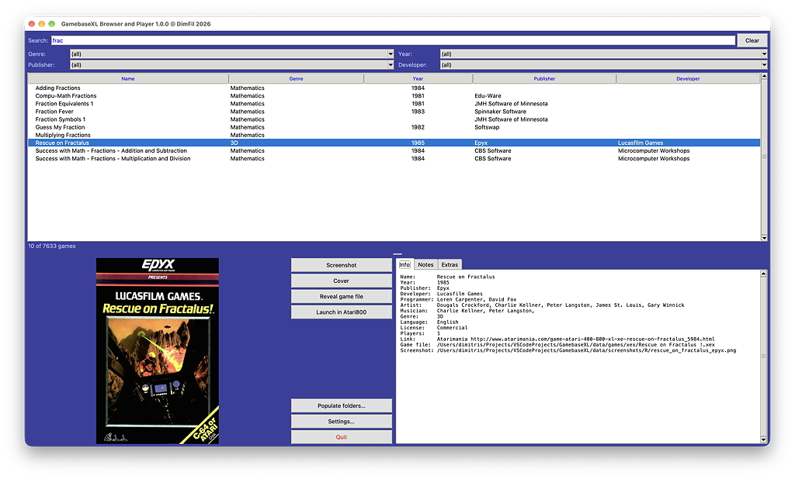
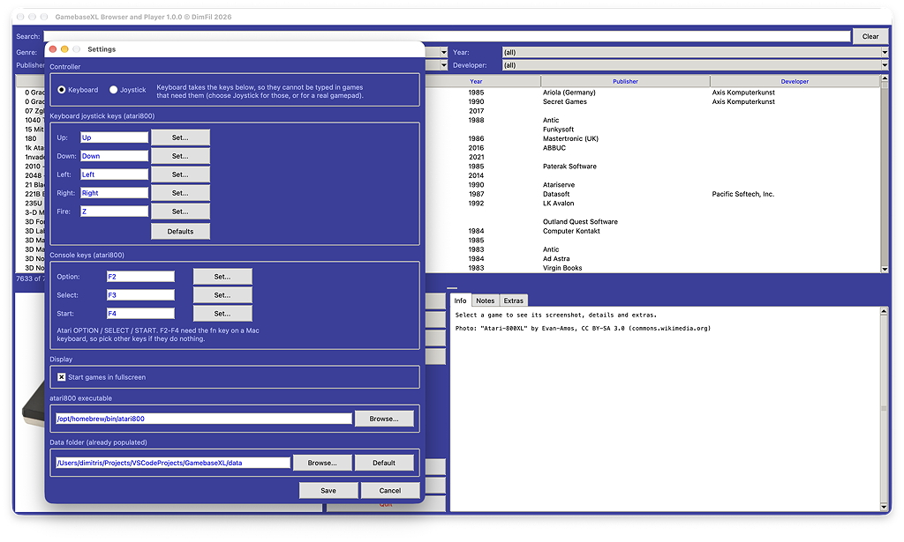
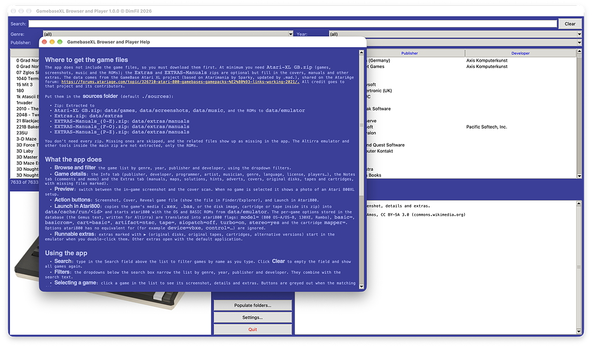
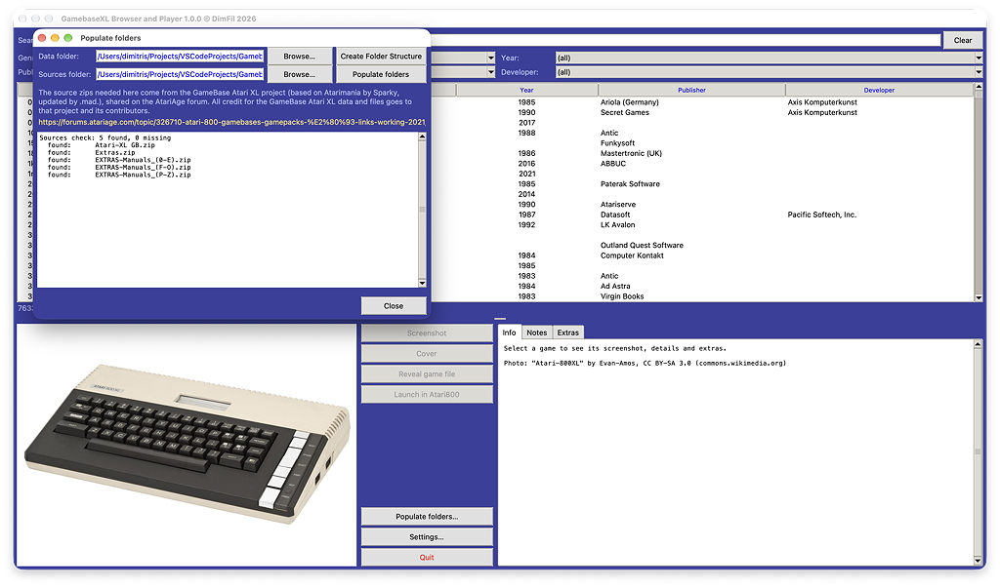
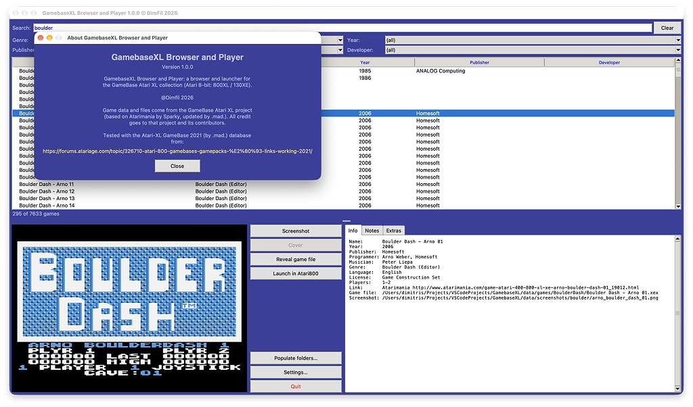

# GamebaseXL Browser and Player

GamebaseXL Browser and Player is a desktop browser and player for the **GameBase Atari XL** collection of Atari 8-bit (800XL / 130XE) games. It reads the bundled game database (`atarixl.sqlite3`, converted from the original `Atari-XL.mdb` with `mdb2sqlite.py` for easier access), shows each game's metadata, screenshot, cover, music and extras (manuals, maps, hints, adverts, box scans…), and launches games in the [atari800](https://atari800.github.io/) emulator with one click.

The app does not ship the game files. You supply the GameBase Atari XL source zips, and the app extracts them into a `data/` folder.

**This repository contains no games, ROMs or other copyrighted media**, only the code and the game database. You are responsible for having the right to use the software you download and run.

Tested with the **Atari-XL GameBase 2021 (by .mad.)** database and source zips from <https://forums.atariage.com/topic/326710-atari-800-gamebases-gamepacks-%E2%80%93-links-working-2021/>. Other versions of the database or zips may differ in layout and are not guaranteed to work.

Developed and tested on macOS (Apple Silicon) with atari800 7.2.1. The code also handles Windows and Linux paths, but those platforms are untested.

## What the app does

- **Browse and filter** the game list by genre, year, publisher and developer, using the dropdown filters.
- **Game details**: the *Info* tab (publisher, developer, programmer, artist, musician, genre, language, license, players…), the *Notes* tab (comments and memo) and the *Extras* tab (manuals, maps, solutions, hints, adverts, covers, original disks, tapes and cartridges, with missing files marked).
- **Preview**: switch between the in-game screenshot and the cover scan. When no game is selected it shows a photo of an Atari 800XL setup.
- **Action buttons**: *Screenshot*, *Cover*, *Reveal game file* (show the file in Finder/Explorer), and *Launch in Atari800*.
- **Launch in Atari800**: copies the game's media (`.xex`, `.bas`, or the disk image, cartridge or tape inside its zip) into `data/cache/run/<id>` and starts atari800 with the OS and BASIC ROMs from `data/emulator`. The per-game options stored in the database (the *Gemus* text, written for Altirra) are translated into atari800 flags: `model=` (800 OS-A/OS-B, 130XE, Rambo), `basic=`, `basicrom=`, `cart=basic*`, `artifact=ntsc`, `tape=`, `siopatch=off`, `turbo=on`, `stereo=yes` and the cartridge `mapper=`. Options atari800 has no equivalent for (for example `device=vbxe`, `control=…`) are ignored.
- **Runnable extras**: extras marked with ▶ (original disks, original tapes, cartridges, alternative versions) start in the emulator when you double-click them. Other extras open with the default application.

## Screenshots

**Main window**



**Searching and selecting a game**



**Settings**



**Help**



**Populate folders**



**About**



## Using the app

- **Search**: type in the *Search* field above the list to filter games by name as you type. Click **Clear** to empty the field and show all games again.
- **Filters**: the dropdowns below the search box narrow the list by genre, year, publisher and developer. They combine with the search text.
- **Selecting a game**: click a game in the list to see its screenshot, details and extras. Buttons are greyed out when the matching file is missing.
- **Launching a game**: select it and click **Launch in Atari800**, or double-click it in the list. atari800 must be installed (see *Settings*), and the game's file must be present in the data folder.
- **Other buttons**: **Populate folders…** extracts the source zips, **Settings…** configures the controller, atari800 and the data folder, and **Quit** closes the app.

## Requirements

- Python 3.8 or newer with Tk (the standard `tkinter`)
- [Pillow](https://python-pillow.org/) (`pip install -r requirements.txt`)
- [atari800](https://atari800.github.io/) to launch games (macOS: `brew install atari800`). Browsing works without it.
- The OS and BASIC ROMs in `data/emulator`. They come from the Altirra folder of the main source zip and are extracted by *Populate folders* (`800XL.ROM`, `800XE.ROM`, `OSAPAL.ROM`, `OSBNTSC.ROM`, `BASIC-A/B/C.ROM`).

Run the app:

```sh
python gamebaseXL.py
```

## Populating the folders

The app finds files under a **data folder** (default `./data` next to the app). Its layout is:

```
data/
├── games/              xex/, basic/, disk/, mania/, BoulderDash/ … (the game files)
├── screenshots/        in-game screenshots
├── music/              SAP music
├── extras/             covers, adverts, maps, hints, carts, original disks/tapes…
│   └── manuals/        manuals (PDF)
├── cache/              temporary media created at launch
└── emulator/           OS and BASIC ROMs (and atari800.exe on Windows)
```

### 1. Get the source zips

The app does not include the game files, so you must download them first. At minimum you need `Atari-XL GB.zip` (games, screenshots, music and the ROMs); the `Extras` and `EXTRAS-Manuals` zips are optional but fill in the covers, manuals and other extras. The data comes from the GameBase Atari XL project (based on Atarimania by Sparky, updated by .mad.), shared on the AtariAge forum: <https://forums.atariage.com/topic/326710-atari-800-gamebases-gamepacks-%E2%80%93-links-working-2021/>. All credit goes to that project and its contributors.

Put them in the **sources folder** (default `./sources`):

| Zip | Extracted to |
| --- | --- |
| `Atari-XL GB.zip` | `data/games`, `data/screenshots`, `data/music`, and the ROMs to `data/emulator` |
| `Extras.zip` | `data/extras` |
| `EXTRAS-Manuals_(0-E).zip` | `data/extras/manuals` |
| `EXTRAS-Manuals_(F-O).zip` | `data/extras/manuals` |
| `EXTRAS-Manuals_(P-Z).zip` | `data/extras/manuals` |

You don't need every zip. Missing ones are skipped, and the related files show up as missing in the app. The Altirra emulator and other tools inside the main zip are not extracted, only the ROMs.

### 2. Extract them

**From the app:** click **Populate folders…**.

1. Optionally pick a different *Data folder* and *Sources folder* with **Browse…**. The dialog checks the sources folder straight away and lists each expected zip as found, MISSING, UNREADABLE or not needed.
2. Click **Create Folder Structure** to create the empty `data/` tree.
3. Click **Populate folders** to extract the zips. Progress appears in the log.

**From the command line:**

```sh
python populate.py --dry-run   # show what would be extracted
python populate.py             # extract
```

Re-running is safe. Files that already exist with the same size are skipped, and unsafe zip paths are ignored. The manuals zips are about 6 GB in total, so extracting them takes a while.

On first start, if `data/games` holds no files, the app tells you the data needs populating.

Names are matched case-insensitively and ignore macOS/Windows Unicode differences, so a collection extracted on one OS works on another.

## Settings

Open **Settings…** from the main window. Everything is saved in `config.json` next to the app.

| Setting | What it does |
| --- | --- |
| **Controller** | *Keyboard* uses the keys below as joystick 1 (`-kbdjoy0`). *Joystick* turns the keyboard joystick off so a real gamepad is used and every key stays free for typing, which text adventures and BASIC games need. |
| **Keyboard joystick keys** | Choose the keys for Up, Down, Left, Right and Fire. Click **Set…** and press a key. Defaults: arrow keys and Space. **Defaults** resets them. atari800's own default is the numeric keypad, which laptops lack. Your `~/.atari800.cfg` is never modified: the keys are written to `data/cache/atari800.cfg` at launch. Function keys are not accepted here because atari800 uses them for its own menus. Fire on Space conflicts with games that use the space bar (for example Hold Game in Airwolf): choose another Fire key for those. |
| **Console keys** | The Atari's OPTION, SELECT and START buttons, which many games use in their menus. atari800 uses F2, F3 and F4, and macOS keeps those for brightness and Mission Control unless you hold `fn`, so pick other keys (for example Tab) if they do nothing. These three rows also accept function keys. |
| **Start games in fullscreen** | Passes `-fullscreen` to atari800. |
| **atari800 executable** | Path to the atari800 executable. If it is empty, the app searches `ATARI800_PATH`, the saved setting, `data/emulator`, your `PATH`, and the usual install locations (Homebrew, `/usr/local/bin`, Program Files). |
| **Data folder** | Point the app at a data folder elsewhere, for example on an external drive. If the new folder has no structure or no game files, the app offers to open the *Populate folders* window for it. |

## Converting the database

`atarixl.sqlite3` was produced from `Atari-XL.mdb` with:

```sh
python mdb2sqlite.py [source.mdb] [target.sqlite3]
```

It needs [mdb-tools](https://github.com/mdbtools/mdbtools) (`brew install mdb-tools`) and keeps the original schema, indexes and rows.

## Building a standalone app

```sh
pip install pyinstaller pillow
python build.py
```

This builds with PyInstaller into `dist/`, and copies `atarixl.sqlite3` and `data/emulator` next to the app. The large game data is not bundled. Choose its folder in Settings, or place it next to the app as `data/`.

The copied `data/emulator` folder holds the OS and BASIC ROMs from your own populated data, so don't publish or redistribute `dist/`.

## Credits

- Game data and files: the GameBase Atari XL project and its contributors (see above).
- Banner photo: "Atari-800XL" by Evan-Amos, CC BY-SA 3.0. See `images/CREDITS.txt`.
- Concept and structure follow the GamebaseST Browser and Player project by the same author.

## License

The code is released under the [MIT License](LICENSE). The GameBase Atari XL data and files and the banner photo are covered by their own terms, as described in Credits.
